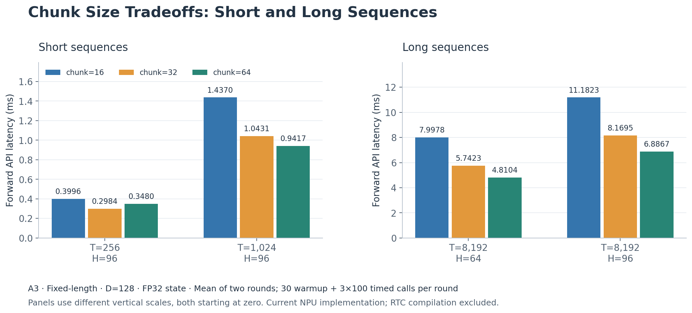
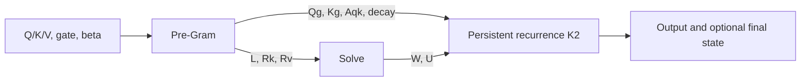
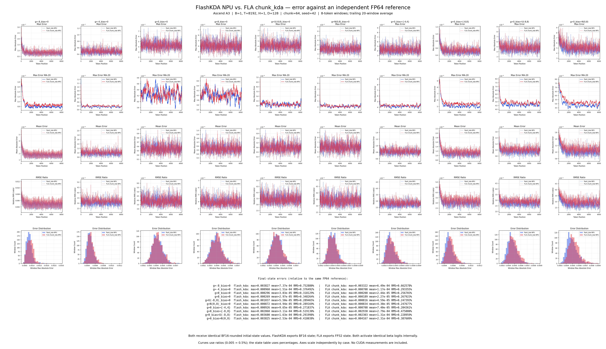
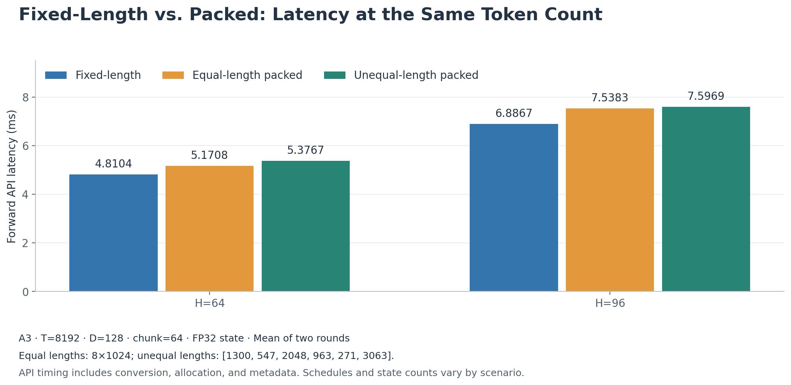

# FlashKDA NPU: AscendC Implementation and Design Tradeoffs

*2026-10-21*

FlashKDA NPU implements the Kimi Delta Attention forward pass in AscendC. It uses 64-token chunks by default and divides computation into three logical stages: Pre-Gram, Solve, and persistent recurrence. The Vector engine handles normalization, gating, and state updates; the Cube engine handles dense matrix multiplication. State is retained in FP32 across chunks, while Cube operands are primarily BF16.

Following the structure of the [CUDA v1 deep-dive](../../docs/20260420-flashkda-v1-deep-dive.md), this document explains these design choices and presents accuracy and performance measurements for the current NPU implementation on A3.

## 1. Chunk Size: Why 64 Is the Default

CUDA v1 uses `CHUNK=16`. The NPU implementation defaults to `KDA_CHUNK=64` and also supports 16 and 32. Configuration is read when the Python module is imported; changing it requires a new process.

Larger chunks reduce recurrence iterations, let each Cube matrix multiplication cover more tokens, and reduce handoffs between chunks. However, the cost of the Gram computation and triangular solve grows with chunk size, as does the on-chip storage needed for intermediate results. A chunk size of 64 is the current choice for long sequences, rather than an optimum for every input.

The following measurements use the warmed-up `flash_kda.fwd` API on the same A3 device. All inputs have fixed sequence lengths, FP32 initial and final states, and D=128. Latencies are in milliseconds.

*Figure 1: Each bar is the mean latency across two rounds. The short- and long-sequence panels use separate vertical scales, both starting at zero. Chunk=32 is fastest at T=256; chunk=64 is fastest for the other shapes shown. [SVG version](assets/npu-chunk-latency.svg).*

| T | H | chunk=16 | chunk=32 | chunk=64 |
| ---: | ---: | ---: | ---: | ---: |
| 256 | 96 | 0.3996 | **0.2984** | 0.3480 |
| 1024 | 96 | 1.4370 | 1.0431 | **0.9417** |
| 8192 | 64 | 7.9978 | 5.7423 | **4.8104** |
| 8192 | 96 | 11.1823 | 8.1695 | **6.8867** |

Supporting larger chunks requires addressing two constraints:

- **On-chip capacity.** Pre-Gram processes row-wise operations in batches of 16 rows, retaining only the gate information that requires prefix accumulation for the whole chunk. This avoids materializing all FP32 temporary values simultaneously in the 192 KiB UB.
- **Exponent range.** A 64-token chunk is divided into two 32-token gate segments. Exponentials are recentered around a reference position within each segment to avoid overflow or underflow from full-chunk cumulative exponents. Cross-segment Gram operands are reconstructed around a common reference so that paired exponential factors cancel correctly.

## 2. Pipeline: Dividing Work Between Vector and Cube

The NPU path has three logical stages. Each stage may contain multiple kernel launches, especially Solve, which runs in slices. Three stages therefore do not imply exactly three kernel launches per forward pass.

### Pre-Gram: Parallel Computation Within Each Chunk

This stage distributes work over sequence chunks and heads. AIV (Vector) normalizes Q/K, activates gate and beta, accumulates gate prefixes, and prepares Cube operands. The paired AIC (Cube) computes the Gram matrices; AIV then applies triangular masks and dtype conversions.

Cube handles the dense matrix multiplications. Its FP32 Gram results are passed directly to AIV for postprocessing in the same buffer, avoiding an additional temporary allocation. READY/DONE handshakes between cores establish when data is ready to read. Local events within each engine wait for transfers to finish so that the next iteration cannot overwrite storage still in use.

### Solve: Vector Solves Diagonal Blocks, Cube Handles Coupling

Solve computes the inverse of the lower-triangular system and the W/U matrices used by recurrence. Chunk=16/32 uses a single-level triangular solve; chunk=64 splits the system into two 32×32 diagonal blocks.

For the block matrix

\[
I+L=\begin{bmatrix}A&0\\C&B\end{bmatrix},
\qquad
(I+L)^{-1}=\begin{bmatrix}A^{-1}&0\\-B^{-1}CA^{-1}&B^{-1}\end{bmatrix},
\]

AIV can solve both diagonal blocks in batches, after which AIC computes the off-diagonal coupling term. This breaks a larger serial triangular problem into smaller Vector solves and Cube matrix multiplications. The formula describes the mathematical decomposition; the implementation also uses BF16 operands and introduces rounding error.

The default chunk=64 path combines inverse assembly and W/U computation in one Cube launch. Vector and Cube work on different slices can overlap on separate streams, with events enforcing dependencies. Recurrence waits for Solve to finish before reading its results.

### Persistent Recurrence: Keeping State On Chip Across Chunks

Within a head, each sequence chunk depends on the state updated by the preceding chunk, so recurrence must proceed sequentially across chunks. K2 runs this loop on the device, traversing the chunks in a single kernel invocation and avoiding Python kernel launches for individual chunks. Different heads have no such dependency and can still run in parallel.

Each block handles up to four heads to balance on-chip capacity and scheduling across heads. AIV keeps FP32 state slices resident in UB without converting them to BF16 between chunk updates, reducing accumulated rounding error. When matrix multiplication is needed, it creates a BF16 copy for AIC. Cube returns FP32 results, and AIV updates the state and output. The BF16 copy is used only for matrix multiplication; it does not replace the FP32 accumulated state.

Persistent execution also removes full FP32 state reads and writes to global memory (GM) between sequence chunks. Cube and Vector still exchange intermediate results through GM, but workspace is allocated per head and reused across chunks, so its capacity does not grow with sequence length. If the upper-level framework does not request a final state, the implementation skips its buffer allocation and writeback. The final chunk also skips intermediate state writes that no subsequent computation will read.

## 3. Numerical Precision: Where FP32 Is Retained

The CUDA deep-dive describes the choice to store BF16 state between chunks. The current NPU implementation retains FP32 state across chunks to reduce repeated rounding; the rest of the computation still uses mixed precision.

| Data | Precision and purpose |
| --- | --- |
| Public Q/K/V/g inputs and output | BF16 |
| Internal beta and initial state | BF16 inputs are converted to FP32 after API input validation |
| Normalized Q/K and gate-scaled operands | Formed as Cube inputs using the current BF16 rounding convention |
| Triangular matrix L and diagonal-solve intermediates | FP32 |
| Inverse matrix and W | BF16 |
| U and D1/D2/D3/D4 handoff results | FP32 |
| Recurrent state across chunks | FP32 resident in UB; a BF16 copy is passed to Cube |
| Final state | Written as BF16 or FP32, as requested by the upper-level framework |

Retaining U and recurrence multiplication results in FP32 avoids another rounding step before residual or output addition. This is especially useful when two large terms cancel in the presence of a large initial state. Rk/Rv/Kg and the transposed residual are each stored in BF16 to limit intermediate storage and matrix multiplication costs.

### Measurements Against an Independent FP64 Reference

The NPU tests use a CPU FP64 mathematical reference. The following fixed-length gate sweep uses B=1, T=8192, H=1, D=128, chunk=64, and seed=42, with BF16 initial and final states.

Relative RMS is `RMS(actual − reference) / RMS(reference)`. Values in the table below are percentages, and output metrics cover the full sequence.

*Figure 2: The 5×10 panel layout follows the original CUDA figure. Blue denotes NPU FlashKDA; red denotes NPU FLA chunk_kda. Each column corresponds to one gate/bias setting. The five rows show maximum absolute error per 8-token window, the trailing 20-window mean of maximum errors, mean absolute error, relative RMS, and a histogram of window maximum absolute errors. Final-state maximum error, mean error, and relative RMS appear at the bottom. [High-resolution PNG](assets/npu-compare-with-fla.png) · [SVG version](assets/npu-compare-with-fla.svg).*

RMS curves use ratios (0.005 means 0.5%), while the state table at the bottom and the table below use percentages. Vertical scales vary between scenarios, but the two curves within each panel share the same scale. Both implementations use the same 30 histogram bins within each scenario. The smoothed curve is the actual mean over up to 20 windows, including the current window.

This figure comes from rerunning both NPU implementations on A3 with FLA 0.6.0 and Triton Ascend 3.2.2. `FLA_FLASH_KDA=0` prevents FLA from dispatching back to FlashKDA. Both implementations receive identical BF16 Q/K/V/g and beta logits, use the same initial-state values after BF16 rounding, and are compared against the same CPU FP64 mathematical reference. Both apply beta sigmoid internally. Reference outputs and states are exported as FP32 before error calculation. FlashKDA receives and returns BF16 state; FLA receives the same values in FP32 and returns FP32 state. The final-state comparison therefore also reflects the difference in output dtype.

FlashKDA's global output/state RMS values for all ten scenarios match the independent API tests. For `g=-8, bias=0`, FLA has a global output RMS of **0.552050%** and a final-state RMS of **0.662578%**. These above-threshold results are retained in the figure to show the measured errors; they are not counted as passing accuracy acceptance. A separate [global RMS summary chart](assets/npu-gate-accuracy.png) is also available.

| gate / bias | Output RMS | Final-state RMS |
| --- | ---: | ---: |
| g=-8, bias=0 | 0.499272% | **0.752880%** |
| g=-4, bias=0 | 0.307547% | 0.376492% |
| g=0, bias=0 | 0.393172% | 0.318129% |
| g=8, bias=0 | 0.396336% | 0.348264% |
| g=U(-8,8), bias=0 | 0.343603% | 0.289465% |
| g=N(0,8), bias=0 | 0.339333% | 0.289169% |
| g=0, bias=±4 | 0.278184% | 0.271837% |
| g=0, bias=±8 | 0.307917% | **0.519130%** |
| g=0, bias=U(-8,8) | 0.276226% | 0.291998% |
| g=0, bias=N(0,8) | 0.285935% | 0.418038% |

In the gate sweep, the output threshold is 0.5% for fixed-length inputs and 0.6% for packed inputs. Final-state threshold violations produce warnings, following the CUDA gate tests. The two bold state values are known warnings. The global output metric for `g=-8` is also close to the threshold; passing with one seed does not establish ample margin for every input. Windowed errors in this sweep are diagnostic and are not asserted separately.

Other mathematical accuracy tests retain their hard assertions: the usual RMS threshold is 0.5%, with 0.6% for some packed outputs. Output transients with a large `arange` initial state allow 1%, while tokens after the first 64 in each sequence must still meet 0.5%. Some native tests use elementwise tolerances or bitwise comparisons. Non-finite values always fail.

CUDA's `torch.equal` tests compare against a reference that emulates its instructions and rounding, which measures something different from error against an independent FP64 mathematical reference. In addition, CUDA gate tests generate random inputs on the GPU and pass the original FP32 initial state to the reference. NPU tests generate inputs on the CPU and use identical BF16-rounded initial-state values for the reference and kernel. We therefore do not compute accuracy improvement ratios against historical CUDA figures.

## 4. Other Optimizations: Reducing Data Movement and Idle Time

### Access Input and Output Buffers Directly to Avoid Full-Tensor Repacking

The upper-level framework supplies Q/K/V/g tensors in `[B,T,H,D]` layout. Kernels compute addresses in that layout and write results directly into output buffers supplied by the framework. This avoids copying and repacking the full input before computation and copying temporary outputs back afterward, reducing temporary storage and memory bandwidth use. Intermediate computation workspaces are still required.

When the sequence length is not a multiple of the chunk size, the final chunk reads only valid tokens, zero-fills the remaining positions in on-chip UB, and writes only valid output positions. Padded positions use zero log gate decay so that they neither further decay nor update the state. No full-input copy is needed for alignment.

For packed inputs containing concatenated variable-length sequences, kernels use a small table of sequence offsets, lengths, and chunk ranges to locate the original data. Each sequence pads only its final chunk, without padding every sequence to the longest length. If all sequences are equally sized, nonempty, and chunk-aligned, the same storage is viewed directly as a fixed-length batch without copying. Reading sequence boundaries on the host still incurs synchronization overhead, which is included in the `flash_kda.fwd` API benchmarks.

### Schedule Work Using Actual Head Lengths

Pre-Gram selects its unroll factor based on the Cube core count, workload, and block launch cost, avoiding large numbers of small blocks merely to save a few loop iterations. K2 selects its grid using the actual number of heads in each block and their estimated completion time.

For unequal-length packed sequences, the scheduler also considers grouping heads of similar lengths to reduce the tail periods where only one head remains active. It switches mappings only when the estimated gain is at least 16 chunk steps and 5%. Shape decisions are cached and reused. This is a heuristic and does not replace measurements for the target shape.

### Reuse On-Chip Storage and the Transposed Layout

UB temporary storage is reused according to value lifetimes to leave room for resident FP32 state. The transposed residual Vt is written to GM once per chunk in a packed fractal layout. Cube uses different load strides to obtain the required operand views, avoiding a separate transposed copy. Local events and cross-core flags protect reused storage; variable lifetimes alone do not justify removing synchronization.

### Reuse Graphs to Reduce Repeated Scheduling

Repeated calls with fixed shapes and addresses can use explicit capture/replay or enable automatic caching with `KDA_AUTO_GRAPH=1`. By default, the automatic cache runs three eager calls, then captures and replays on the fourth. Changes to addresses, shapes, or relevant parameters trigger a new cache lookup. Packed inputs bypass the automatic cache.

Graphs primarily reduce repeated launch and allocation overhead. They retain input/output tensors and private workspaces, requiring stable buffers and ordered input updates. They do not remove the computation cost of recurrence itself.

## 5. A3 Performance and Validation Coverage

The test device is `Ascend910_9382`, with 24 Cube cores and 48 Vector cores. The environment uses CANN 9.1.0, PyTorch 2.9.0+cpu, and torch_npu 2.9.0.post6. The RTC compilation target is `Ascend910B3`.

The following table uses the default chunk=64, B=1, D=128, and FP32 initial and final states. Equal-length packed inputs contain 8×1024 tokens; unequal-length packed inputs use `[1300,547,2048,963,271,3063]`.

*Figure 3: All scenarios have 8192 total tokens. Bars show the mean latency across two rounds for H=64/96. [SVG version](assets/npu-packed-latency.svg).*

| T | H | Scenario | Forward latency (ms) |
| ---: | ---: | --- | ---: |
| 256 | 96 | Fixed-length | 0.3480 |
| 1024 | 96 | Fixed-length | 0.9417 |
| 8192 | 64 | Fixed-length | 4.8104 |
| 8192 | 64 | Equal-length packed | 5.1708 |
| 8192 | 64 | Unequal-length packed | 5.3767 |
| 8192 | 96 | Fixed-length | 6.8867 |
| 8192 | 96 | Equal-length packed | 7.5383 |
| 8192 | 96 | Unequal-length packed | 7.5969 |

Benchmarks run in two rounds, each with 30 warmup calls and 3×100 timed calls. The table reports the mean of the two round means. RTC compilation and warmup are excluded. NPU Event timing covers dtype conversion, workspace allocation, metadata processing, and kernel launches within `flash_kda.fwd`.

Completed validation runs are listed below. Each row is a separate run; the counts should not be summed as a deduplicated coverage total.

| Validation run | Passed | Skipped | Notes |
| --- | ---: | ---: | --- |
| Full chunk=16 matrix, including long sequences | 927 | 100 | Skips inapplicable tail parameters, other chunk configurations, and cross-device cases without a visible second device |
| Full chunk=32 matrix, including long sequences | 959 | 68 | Same skip categories as above |
| Remaining chunk=64 native long-sequence cases | 4 | 0 | 131072, 1048576, tail length 65537, packed `[65537,17,63]` |
| API recheck | 21 | 2 | 20 gate scenarios and the current chunk configuration; 2 other chunk configurations skipped, with 2 state warnings retained |

None of these runs had an accuracy assertion failure. The two gate final-state threshold violations remain warnings under the established criteria. Passing the tests does not mean every output/state metric is below 0.5%.

## 6. Code Structure, Data Layouts, and Synchronization

### Entry Points and Responsibilities

| File | Responsibility |
| --- | --- |
| [kda_fwd.py](../kda_fwd.py) | Validates input formats and dispatches to the fixed-length or packed path. |
| [ascendc.py](../ascendc.py) | Compiles kernels through RTC, selects schedules, allocates workspaces, and launches the computation stages. |
| [csrc/flash_kda.cpp](../csrc/flash_kda.cpp) | Bridges the low-level RTC compilation and launch APIs and checks arguments against the native ABI. |
| [auto_graph.py](../auto_graph.py) | Caches and reuses graphs within the current thread when automatic graphs are enabled. |
| [graphs.py](../graphs.py) | Provides explicit graph capture and retains framework-supplied tensors and graph-specific workspaces for replay. |

The eager call path is `fwd → _run_ascendc → kda_fwd_ascendc`. Automatic graph reuse occurs after API input validation. Explicit capture calls `_run_ascendc` directly to avoid recursively entering automatic capture.

Section 2 describes the device stages. Within Solve, `fwd_kernel1_solve_wide.cpp` performs AIV diagonal solves, `fwd_kernel1_solve_assemble.cpp` assembles the two-level inverse on AIC, and `fwd_kernel1_solve_cube.cpp` computes W/U. `fwd_kernel1_solve_fused.cpp` combines assembly and W/U computation into one Cube launch.

### Intermediate Data and Packed Metadata

In the table below, C is the number of tokens per chunk, D=128, and N is the number of sequences. Chunk/head workspaces group each sequence's consecutive chunks by head. Section 3 explains the precision choices.

| Data | Layout and storage requirements |
| --- | --- |
| Public Q/K/V/g inputs and output | Contiguous `[B,T,H,D]`, BF16; accessed directly without full-input repacking or output permutation. |
| beta, initial state, and gate | Framework-supplied BF16 beta and BF16 initial state are converted to FP32 before execution; gate conversion occurs in UB. |
| Pre-Gram output | `qg/kg/rk/rv` are BF16 `[C,D]` tiles; `L` is FP32 `[C,C]`; `Aqk16` is BF16 `[C,C]`; decay is FP32 `[D]`. |
| Solve output | Inverse is BF16 `[C,C]`; W is BF16 `[C,D]`; U is FP32 `[C,D]`. Entries padded for batched Solve launches do not participate in recurrence. |
| Recurrent state | Public layout is `[N,H,D,D]`; FP32 is retained in UB across chunks, with a BF16 copy for Cube. Final state is written in the dtype requested by the upper-level framework. |
| Recurrence handoffs | D1/D2/D3/D4 are FP32; Vt uses packed BF16 fractal layout; each head's workspace is reused across chunks. |

Except for the fixed-length view path for equal-length, nonempty, chunk-aligned sequences, packed inputs use INT64 metadata rows `(token start, token count, chunk start, chunk count)`. Sequence rows are followed by a sentinel row and optional head-map rows. Empty sequences preserve their initial state, or return zero state when no initial state is supplied. Host metadata packing, kernel parsing, and positional launch arguments must remain consistent.

### Synchronization and Memory Ownership

Pre-Gram's paired AIC/AIV exchange data through READY/DONE cross-core handshakes. Persistent recurrence uses per-head flags to protect operand handoffs and workspace reuse. Local events protect aliased UB/L0 storage.

When Solve overlaps work on separate streams, the Vector stream first waits for the stream running `flash_kda.fwd` (the entry stream) to finish Gram computation. The Cube stream waits for the corresponding Vector slice, and the entry stream waits for Cube completion before launching recurrence. The single-stream path preserves the same dependencies through stream order.

Graphs retain framework-supplied tensors and graph-specific workspaces for later replay. The automatic cache belongs to the current thread; its key includes the stream, tensor storage addresses and layouts, scalar parameters, and relevant environment settings. Import-time configuration changes require a new process. Cache eviction must wait for outstanding replay before releasing storage. Concurrent explicit replays should use separate capture objects and output buffers, and input updates must be ordered with the replay stream.

## 7. Code Index

- [Pre-Gram](../csrc/ascendc/fwd_kernel1_pre_gram.cpp), [Vector Solve](../csrc/ascendc/fwd_kernel1_solve_wide.cpp), [Inverse Assembly](../csrc/ascendc/fwd_kernel1_solve_assemble.cpp), [W/U Cube](../csrc/ascendc/fwd_kernel1_solve_cube.cpp), [Fused Cube Solve](../csrc/ascendc/fwd_kernel1_solve_fused.cpp), [Persistent Recurrence](../csrc/ascendc/fwd_kernel2_persistent.cpp).
- [Scheduling and RTC Orchestration](../ascendc.py), [Build, API, and Run Commands](../README.md). Section 6 covers code structure, data layouts, and synchronization.
